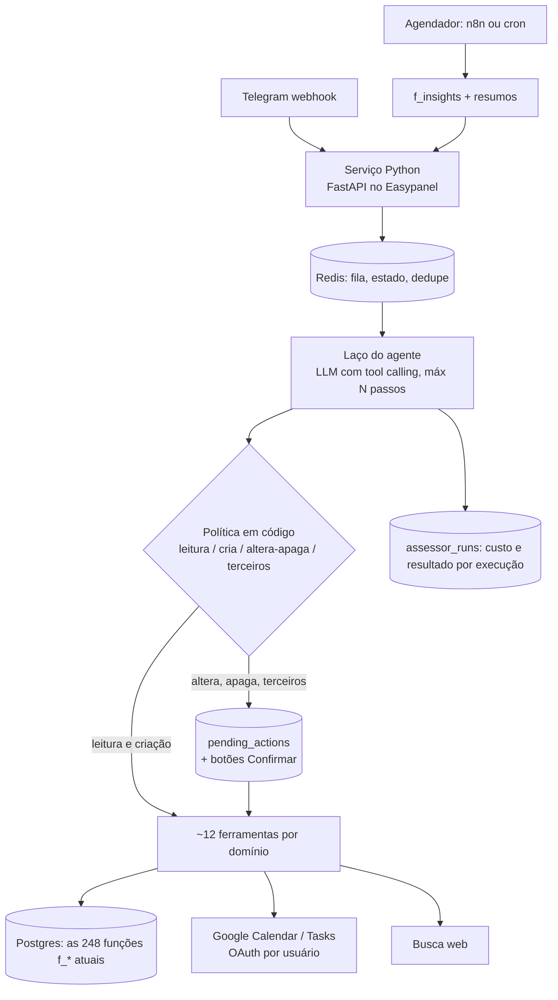

# Arquitetura do Assessor (proposta, 10/11/2026)

Origem: grilling "assessor pessoal × o que já existe". Decisão tomada na Pergunta 1: o assessor se diferencia por
**cruzar áreas** e **tomar iniciativa com critério**, não por ter mais intenções. Pedidos abertos (busca, passagens,
restaurantes) entram como ferramenta do agente, não como intenção nova.

Nada desta proposta foi aplicado. Regras do `PLANO-MELHORIAS.md` continuam valendo (nada vai para produção sem o dono).

## 1. Ponto de partida (o que já temos e serve)

| Peça existente | Papel no assessor |
|---|---|
| Roteador fixo (`Montar pedido a IA` → `Interpretar resposta` → Switch, 30 intents) | **Fica.** Caminho rápido e barato para pedidos diretos. |
| Execução determinística (Postgres, Calendar, Telegram) + botões de confirmação | **Fica.** O agente não escreve; ele propõe um JSON de intenção que entra nesse mesmo caminho. |
| Sub-workflows `Agenda * - listar`, `Chamar relatorio` (`f_report_data`), `Pesquisa: executar`, `Google Tasks`, `Projetos: Google (leitura)` | Viram **ferramentas** do agente (n8n "Call n8n Workflow Tool"). |
| `f_summary_data`, `f_fin_spent`, `f_fin_budget`, `f_fin_limit_text`, `f_card_sum`, `f_doc_search`, `f_proj_progress`, estoque | Matéria-prima do **retrato unificado** (SQL, sem IA). |
| `f_mem_prompt_txt` / `user_memory` (db/035, não aplicado) | Contexto pessoal do agente. |
| `f_suggest_pick` + `suggestions_log` (1/dia, 30 dias por chave) | Modelo para o **Vigia** proativo (mesma disciplina anti-spam). |
| `ai_usage`, `ai_pricing` (inclui `tool:web_search`), `f_ai_log`, `/custo` | Base da **contabilidade custo × valor**. |
| `Agente | Disparador` (resumo da manhã e do fim do dia) | Canal da iniciativa, **sem execução extra no n8n**. |

O que falta: (a) uma visão que junte as áreas; (b) um laço de raciocínio com ferramentas; (c) regras de iniciativa;
(d) medir valor, não só custo.

## 2. Visão geral

```mermaid
flowchart TD
  M[Mensagem Telegram] --> R[Roteador atual\n30 intents, ~R$0,01]
  R -->|intent direta| X[Execução determinística\n+ confirmação]
  R -->|intent=assessor\ncruza áreas / aberto| A[Sub-workflow Agente | Assessor]
  A --> S[(f_assessor_snapshot\nSQL, R$0)]
  A --> T{AI Agent n8n\nmáx 5 passos}
  T --> T1[agenda_listar]
  T --> T2[financas_relatorio]
  T --> T3[horario_livre]
  T --> T4[docs_buscar / memoria]
  T --> T5[pesquisa_web\nUS$0,01/chamada]
  T -->|resposta| O[Resposta + linha de custo]
  T -->|propostas| P[JSON de intenção\nreusa Interpretar resposta]
  P --> X
  D[Disparador manhã/noite] --> V[(f_insights\nVigia, SQL, R$0)]
  V -->|sinais| D
  O --> L[(assessor_runs\ncusto, ferramentas, resultado)]
  X --> L
```

Três camadas, cada uma com custo próprio e que pode ser entregue sozinha:

### Camada A: retrato unificado (`f_assessor_snapshot`, SQL)
Uma função por usuário que devolve em `jsonb` (e num texto compacto de ~1,5–2 mil tokens) o estado de todas as áreas
para um horizonte (padrão 14 dias):
- dinheiro: gasto do mês, limite e quanto pode gastar por dia, categorias ≥ 80%, contas a pagar, faturas a vencer
  e limite disponível por cartão, metas e quanto falta;
- compromissos de projeto: tarefas atrasadas, prazos próximos;
- estoque: itens que acabam no horizonte;
- documentos: vencimentos no horizonte e se existe lembrete/tarefa para eles;
- memória: até 8 fatos relevantes (`f_mem_relevant_txt`).

A agenda continua vindo do Google Calendar (fonte da verdade, sem `events_cache`): o sub-workflow chama
`Agenda * - listar` uma vez e entrega os eventos junto do retrato.

É o que resolve "posso aceitar o jantar de sexta?" **com uma única chamada à IA**: agenda de sexta + limite do mês +
lazer em 90% + fatura do Itaú que vence dia 15, tudo no mesmo contexto.

### Camada B: agente com ferramentas (`Agente | Assessor`)
- Entrada: nova intent `assessor` no enum (substitui o uso de `misc_query`/`chat` para perguntas que cruzam áreas,
  pedem opinião ou são abertas). Regra de prompt curta: "pergunta de decisão, comparação, planejamento ou que
  precise de mais de uma área → assessor".
- Nó **AI Agent** do n8n (langchain), modelo `gpt-6-luna` por padrão, **máx. 5 iterações**, prompt de sistema próprio
  e compacto (~3 mil tokens). Ele **não** recebe os 44 KB do `rules.json`.
- Ferramentas de **leitura** (rodam direto): `agenda_listar`, `horario_livre`, `financas_relatorio`
  (`f_report_data`), `estoque`, `docs_buscar`, `projetos`, `memoria`, `pesquisa_web` (sub-workflow existente,
  com `f_research_gate`).
- Ferramenta de **escrita: só `propor_acao`**. Ela devolve um ou mais JSON no formato da intenção atual (ex.:
  `create_event`, `finance`, `create_task`). O principal entrega esse JSON ao `Interpretar resposta` e segue o
  caminho de sempre, com as mesmas confirmações. Assim o princípio "o modelo só interpreta; quem executa são os nós"
  e a regra "alterar, apagar e falar com terceiros pede confirmação" continuam valendo sem código novo de execução.
- Escada de modelo: `gpt-6-luna` sempre. Só usa `gpt-6.1-sol` (20× o preço) quando a pessoa pede ("pensa com
  calma") e mostra o custo estimado antes.
- Experiência: o bot manda "pensando…" (`sendChatAction`) e responde em uma mensagem com a linha de custo no fim.

### Camada C: Vigia proativo (`f_insights`, SQL no Disparador)
Regras determinísticas que cruzam áreas e geram **sinais** com chave e prioridade, gravados em `insights_log`
(mesma disciplina do `suggestions_log`: chave não volta por 30 dias, teto por dia):

| Sinal | Cruza |
|---|---|
| Fim de semana com 2+ compromissos de lazer e lazer ≥ 80% do orçamento | agenda × orçamento |
| Fatura vence antes do dia de entrada da renda e o saldo previsto não cobre | cartões × planejamento |
| Documento vence em ≤ 30 dias sem lembrete nem tarefa | documentos × lembretes |
| Remédio acaba antes da próxima ida ao mercado e não está na lista de compras | estoque × listas |
| Prazo de projeto em ≤ 7 dias com tarefas abertas e agenda sem horário livre até lá | projetos × agenda |
| Conflito de horário na semana que vem | agenda |

Entrega: **dentro do resumo da manhã** (bloco "Atenção", até 2 sinais, com botão para a ação proposta). Isso não
cria execução nova no n8n, o que evita o problema que desligou a oferta de salvar e a sugestão do dia. Exceção: um
sinal de prioridade alta (vencimento amanhã, conflito hoje) pode sair na hora, no máximo 1 por dia.
Texto por modelo de frase em SQL (R$ 0). Reescrever com IA é opcional e fica desligado por padrão.

## 3. Custo atrelado ao valor

### Estimativas por operação
Premissas: `gpt-6-luna` US$ 0,10 / 1M tokens de entrada e US$ 0,50 / 1M de saída, dólar R$ 5,44 (`ai_pricing`),
~3,8 caracteres por token. **São estimativas para validar com `ai_usage` depois da primeira semana.**

| Operação | Tokens (entrada / saída) | Custo estimado |
|---|---|---|
| Mensagem comum hoje (roteador, ~57 KB de prompt) | ~15 mil / ~300 | ~R$ 0,009 |
| Camada A: pergunta que cruza áreas, 1 chamada com retrato | ~6 mil / ~500 | ~R$ 0,005 + roteador |
| Camada B: agente, 3–4 passos, sem web | ~30 mil acumulados / ~1,5 mil | ~R$ 0,02 |
| Camada B com 1 pesquisa web | + US$ 0,01 da busca + ~5 mil tokens | ~R$ 0,08 |
| Camada B com `gpt-6.1-sol` | 20× a linha luna | ~R$ 0,40 (sem web) |
| Camada C: Vigia no resumo | só SQL | R$ 0 |

Ordem de grandeza para 2 pessoas, 10 perguntas de assessor por dia cada (1 em 5 com web): ~R$ 0,90/dia, ~R$ 27/mês.
O roteador atual continua sendo a maior parte do volume.

### Ganho de custo que paga o assessor
O prompt de ~57 KB do roteador é enviado a cada mensagem. Se as regras que só servem a perguntas abertas forem
para o prompt do assessor e o roteador encolher pela metade, cada mensagem comum fica ~R$ 0,004 mais barata. Nesse
volume, isso já cobre boa parte do custo da Camada B. Medir antes de prometer.

### Contabilidade de valor (`assessor_runs`)
Cada execução do assessor e cada sinal do Vigia grava: `user_id`, `origem` (pergunta | vigia), `custo_brl` (soma
de `ai_usage` da execução + taxa de ferramenta), `ferramentas[]`, `passos`, `resultado`:
- `acao_confirmada`: a pessoa confirmou uma proposta (criou evento, pagou conta, criou tarefa);
- `aceito`: clicou no botão do sinal;
- `respondido`: só resposta, sem ação;
- `ignorado`: sinal sem clique em 24 h;
- `rejeitado`: clicou "não" ou desfez.

Isso vira duas coisas visíveis:
1. **Linha por resposta**: `Custo: ~R$ 0,02 (agenda + finanças) · mês: R$ 4,10`. Com web, mantém o formato atual da pesquisa.
2. **`/custo` com valor**: "Assessor no mês: R$ 6,30 em 140 usos · 38 ações confirmadas (R$ 0,17 por ação útil) ·
   Vigia: 21 sinais, 9 aceitos, 2 rejeitados". Regra com taxa de rejeição alta é desligada automaticamente
   (ex.: ≥ 3 rejeitados e 0 aceitos em 30 dias).

### Teto e proteção
- `agente:cfg:assessor_budget_brl` por pessoa e por dia (padrão R$ 1,00). Acima dele, o agente responde só com a
  Camada A, sem laço e sem web, e avisa. Mesmo padrão do `research_notice_brl`, mas com corte.
- Máximo de 5 passos e 2 pesquisas web por execução; `f_research_gate` segue valendo.
- Conteúdo da web e de ferramentas é dado, nunca instrução (regra da Pesquisa vale para o agente inteiro).

## 4. Alternativa descartada
Trocar o roteador inteiro por um agente. Custo de 5 a 20× por mensagem, resposta mais lenta, e perde o que dá
segurança hoje: 161 testes offline, schema estrito, execução determinística e confirmações. O assessor entra **ao
lado** do roteador.

## 5. Entrega em fases (cada uma mede valor antes da próxima)

| Fase | Entrega | Custo novo | Critério para seguir |
|---|---|---|---|
| A1 | `f_assessor_snapshot` + intent `assessor` com 1 chamada (sem laço) | ~R$ 0,005/pergunta | ≥ 70% das perguntas de decisão respondidas sem precisar de ferramenta |
| C1 | `f_insights` (6 regras) no resumo da manhã + `insights_log` | R$ 0 | ≥ 30% de sinais aceitos em 2 semanas |
| V1 | `assessor_runs` + linha de custo + `/custo` com valor | R$ 0 | números aparecem para as duas pessoas |
| B1 | Sub-workflow `Agente | Assessor` com ferramentas de leitura + `propor_acao` | ~R$ 0,02/pergunta | ações confirmadas por R$ gasto melhores que A1 |
| B2 | `pesquisa_web` como ferramenta + escada luna → sol | ~R$ 0,08/pergunta com web | uso real de web > 10% das perguntas |
| R1 | Enxugar o prompt do roteador (mover regras para o assessor) | **economia** | `tests/offline` e `casos.json` sem regressão |

A1, C1 e V1 não dependem do nó AI Agent nem de tempo de execução extra no n8n. Elas testam a tese
(cruzar áreas + iniciativa) com custo quase zero, antes de investir no laço de agente.

## 6. Arquivos que cada fase toca
- A1: `db/037_assessor_snapshot.sql`, `tools/n8n-gen/intents/assessor.py` (registro de intenção), `rules.json` (regra curta).
- C1: `db/038_insights.sql`, `tools/n8n-gen/subworkflows/disparador_base.js` (bloco "Atenção") + `gen_disparador.py --check`.
- V1: `db/039_assessor_runs.sql`, `Resposta do custo de IA`, `Preparar envio` (linha de custo).
- B1/B2: `tools/n8n-gen/subworkflows/assessor.sdk.js` + `gen_assessor.py`; testes em `tests/offline/` para os nós Code novos
  (`contrato.test.js` obriga).

## 7. Perguntas em aberto (próximos ramos do grilling)
1. Teto de custo: R$ 1,00 por pessoa por dia está bom? Corta ou só avisa?
2. Vigia: só no resumo da manhã, ou também liberar 1 aviso imediato por dia?
3. O assessor pode cruzar dados **entre** você e a Maria Clara (ex.: horário livre dos dois), ou o isolamento por
   `user_id` continua absoluto?
4. Isso fica pessoal, ou é o primeiro passo para um SaaS? (Muda multi-tenant, credenciais Google por usuário e o
   molde de agenda por pessoa.)

## 8. Arquitetura alternativa: agente em código (Python), n8n na periferia

A proposta das seções 2 a 6 mantém o n8n no centro e pendura o assessor ao lado. Esta alternativa inverte: o
centro passa a ser um serviço Python com laço de agente; o n8n fica só para automações periféricas.



### Como funciona
- **Sem classificador separado.** O modelo recebe ~12 ferramentas por domínio (`agenda`, `financas`, `lembretes`,
  `estoque`, `documentos`, `listas_notas`, `projetos`, `contatos_lugares`, `memoria`, `retrato`, `pesquisa_web`,
  `preferencias`), cada uma com schema estrito. Pedido simples = 1 chamada de ferramenta; pedido que cruza áreas =
  várias, no mesmo laço. Não existe mais a fronteira "intent direta × assessor".
- **A lógica de negócio não é reescrita.** As ferramentas são invólucros finos das funções SQL atuais (`f_fin`,
  `f_callback`, `f_summary_data`, `f_docs`, ...). O que é reescrito é a cola: os 55 nós Code (montagem de pedido,
  formatação de resposta) e o roteamento dos 194 nós.
- **Autonomia controlada vira código, não prompt.** Cada ferramenta declara sua classe. Alterar, apagar e falar com
  terceiros nunca executam direto: gravam em `pending_actions` e mandam os botões. O modelo não consegue pular isso.
- **Iniciativa:** mesmo Vigia (`f_insights`) da seção 2, disparado por cron; opcionalmente uma "revisão da semana"
  feita pelo agente (domingo à noite), com custo medido.
- **Testes:** `pytest` para ferramentas e política; os 91 casos de `tests/natural/casos.json` viram avaliação de
  regressão (mensagem → ferramenta e argumentos esperados), rodável com modelo real ou gravado.

### Comparação

| Critério | Atual (n8n, roteador fixo) | Nova (agente em código) |
|---|---|---|
| Cruzar áreas | Não faz; cada intent é um ramo isolado | Nativo: várias ferramentas no mesmo laço |
| Iniciativa | Resumos fixos; sugestões desligadas por tempo de execução | Vigia em SQL + revisão semanal pelo agente, sem limite de execução do n8n |
| Pedidos abertos / busca | Sub-workflow à parte, uma chamada, sem encadear | Busca é mais uma ferramenta; encadeia com agenda e finanças |
| Custo por mensagem simples | ~R$ 0,009 (prompt de ~57 KB toda vez) | ~R$ 0,005–0,007 (2 chamadas com ~4 mil tokens de prefixo, que entra em cache) |
| Custo por pergunta cruzada | Não disponível | ~R$ 0,02 (sem web), ~R$ 0,08 (com web) |
| Previsibilidade | Alta: schema estrito de intent, fluxo fixo | Média-alta: schema estrito por ferramenta + política em código; a escolha da ferramenta é do modelo |
| Adicionar função | Intent + patch + nós + regra no prompt (44 KB crescendo) | Uma função Python com schema; prompt não cresce |
| Testabilidade | 161 testes offline só dos nós Code; roteamento só no n8n real | Tudo testável local (ferramentas, política, laço com modelo gravado) |
| Depuração | Visual no n8n, bom para fluxo; ruim para JS dentro de JSON | Logs e traces por execução; sem editor visual |
| Tempo de resposta | 1 chamada de IA + nós | 2+ chamadas; simples fica parecido, cruzada leva alguns segundos a mais |
| Caminho para SaaS | Difícil: credencial e sub-workflow por pessoa, sem RLS | Natural: OAuth por usuário, multi-tenant, RLS |
| Operação | Já está de pé; credenciais Google geridas pelo n8n | Você passa a manter deploy, fila, renovação de token Google, monitoramento |
| Custo de construir | Zero (existe) | Alto: reescrever a cola de 30 intents e migrar 2 usuários ativos |
| Risco | Baixo hoje; cresce com o prompt e a cadeia de ~30 patches | Regressão na migração; modelo escolher ferramenta errada (mitigado pela avaliação com os 91 casos) |

### Onde cada uma ganha
- **Atual ganha** em: já funciona, é previsível, não exige operação nova. É a melhor escolha se o Luna continuar
  sendo uma secretária para duas pessoas.
- **Nova ganha** em tudo o que define um assessor (cruzar áreas, encadear busca com dados pessoais, iniciativa
  sem teto de execução) e em tudo o que define um SaaS (multi-usuário, testes, evolução sem inchar o prompt).

### Caminho recomendado: migração por estrangulamento
Não é preciso escolher entre as duas de uma vez:
1. **Fases A1, C1 e V1 como estão** (SQL + n8n). Valem para qualquer arquitetura, porque moram no Postgres.
2. **Fase B1 feita em Python, não no nó AI Agent do n8n.** O n8n chama o serviço por HTTP só na intent `assessor`.
   O serviço nasce pequeno (laço, política, ferramentas de leitura, `propor_acao`) e já é a semente da arquitetura nova.
3. **Mover domínios um a um** do n8n para ferramentas Python, começando pelos de leitura. A cada domínio movido, o
   prompt do roteador encolhe.
4. Quando o roteador só encaminhar, o webhook do Telegram passa a apontar para o serviço e o n8n fica com cron e
   integrações.

O passo 2 custa pouco e é reversível. Os passos 3 e 4 só se justificam se os números de `assessor_runs` mostrarem
valor ou se a resposta sobre SaaS for "sim".

## 9. Decisões do grilling

| # | Pergunta | Decisão | Consequência |
|---|---|---|---|
| 1 | O que diferencia o assessor? | Cruzar áreas e tomar iniciativa com critério; busca como ferramenta | Seções 2 e 3 |
| 2 | Pessoal ou SaaS? | **Protótipo de um SaaS** (12/11/2026) | A arquitetura da seção 8 (agente em código) é o destino; a migração por estrangulamento é o caminho. Multi-tenant, OAuth por usuário e RLS entram no desenho desde o primeiro serviço Python |
| 3 | Canal do SaaS? | **Telegram agora, canal isolado no serviço** (12/11/2026) | Interface única de canal (receber, enviar texto, botões, arquivo); botões viram ação pendente genérica em vez de callback do Telegram; `assessor_runs` grava o canal para separar custo de IA e de canal; WhatsApp só depois de conferir política e preços da Meta |
| 4 | Primeiro cliente e preço? | **Profissional autônomo; franquia mensal no lugar do teto diário** (12/11/2026) | Preço de teste R$ 39/mês (a validar), custo de IA até ~15% do preço; franquia de perguntas de assessor (ex.: 100/mês, 20 com web), acima dela responde só com o retrato; cliente vê franquia e ações concluídas, custo em reais fica em painel interno; casal é o segundo público |
| 5 | Como o cliente conecta o Google? | **Serviço Python dono do OAuth; piloto com app publicado sem verificação; verificação aberta em paralelo** (12/11/2026) | Autorização por link, guardada cifrada por usuário; só escopos de eventos e tarefas; substitui credenciais do n8n e o molde de agenda por pessoa; agenda passa a ser um dos primeiros domínios a migrar; `PRIVACY.md` vira política pública em domínio do produto; onboarding entrega valor antes de pedir o Google |
| 6 | Dados sensíveis no SaaS? | **RLS e aceite registrado antes do primeiro usuário externo** (12/11/2026) | Serviço informa o usuário ao Postgres e o banco recusa linhas alheias; aceite com versão da política, saúde em aceite separado; exclusão e exportação por comando; mínimo de dados para a IA; logs e `assessor_runs` sem conteúdo de mensagem; contrato do provedor de IA documentado; revisão jurídica antes de cobrar; e-mail de contato do produto no lugar do pessoal |
